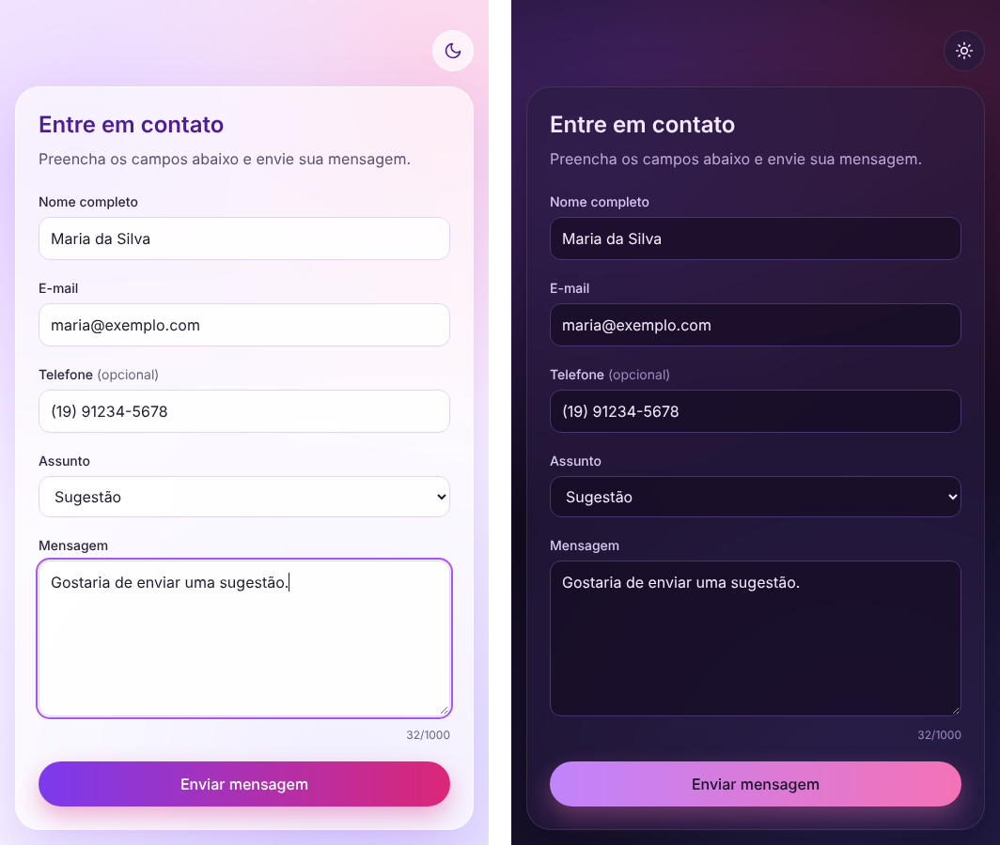

# contact-form-react

Formulário de contato em React, com validação de campos, tema claro e escuro e o código separado em camadas.



## O que ele faz

- Campos de nome completo, e-mail, telefone (opcional), assunto e mensagem.
- Valida cada campo e mostra o erro logo abaixo dele. Ao enviar com erro, o cursor vai para o primeiro campo inválido.
- Aplica a máscara no telefone enquanto a pessoa digita, no formato `(19) 91234-5678`.
- Mostra um contador de caracteres na mensagem.
- Guarda as mensagens enviadas no `localStorage` do navegador.
- Alterna entre tema claro e escuro e lembra a escolha. Na primeira visita, segue o tema do sistema.
- Usa `label`, `aria-invalid` e `aria-describedby` nos campos, então funciona bem com teclado e leitor de tela.

## Regras de validação

| Campo | Regra |
| --- | --- |
| Nome completo | Obrigatório, com nome e sobrenome, só letras, espaços, hífen e apóstrofo, até 100 caracteres |
| E-mail | Obrigatório, em formato válido, até 254 caracteres |
| Telefone | Opcional. Se preenchido, precisa ser um número brasileiro com DDD, fixo ou celular |
| Assunto | Obrigatório: dúvida, sugestão, suporte ou parceria |
| Mensagem | Obrigatória, de 10 a 1000 caracteres |

## Tecnologias

HTML5, CSS3, Tailwind CSS 4, JavaScript, TypeScript, React 19, Vite, Vitest com Testing Library, Git e GitHub.

## Como rodar

É preciso ter o Node.js 20 ou mais novo.

```bash
npm install
npm run dev
```

Depois é só abrir http://localhost:5173 no navegador.

| Comando | O que faz |
| --- | --- |
| `npm run dev` | Inicia o servidor de desenvolvimento |
| `npm test` | Roda os testes |
| `npm run build` | Confere os tipos e gera a versão final na pasta `dist` |
| `npm run preview` | Abre a versão gerada pelo build |

## Estrutura

```
src/
  domain/           Regras do negócio: validação, assuntos, telefone e temas
  application/      Caso de uso de envio e contratos de armazenamento
  infrastructure/   Armazenamento no localStorage e leitura do tema do sistema
  presentation/     Componentes React, hooks e formatação
  testing/          Apoio para os testes
  compositionRoot.ts  Monta as peças e liga cada contrato à sua implementação
```

As dependências só apontam para dentro: `presentation` e `infrastructure` conhecem `application`, e `application` conhece `domain`. O `domain` não importa nada de fora, por isso as regras de validação rodam e são testadas sem React nem navegador.

Para guardar as mensagens em uma API em vez do `localStorage`, basta criar uma nova implementação de `ContactMessageRepository` em `infrastructure` e trocar a linha correspondente no `compositionRoot.ts`.

## Testes

Os testes cobrem as regras de validação, o caso de uso, os repositórios e o fluxo da tela, incluindo erros, máscara do telefone, envio e troca de tema.

```bash
npm test
```
